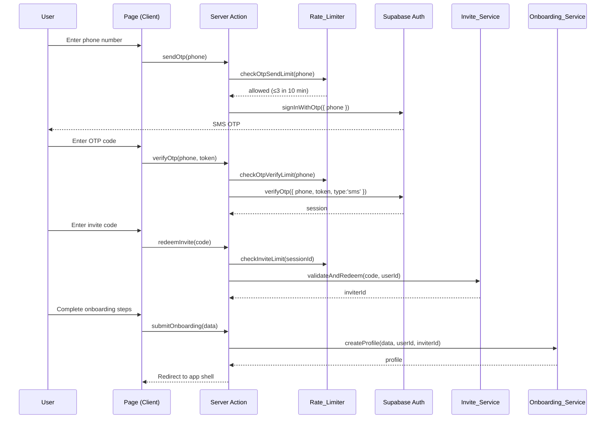

# Design Document: Foundation Auth

## Overview

This document describes the technical design for DivaCrew's foundational authentication and onboarding layer. The feature covers:

- Phone OTP sign-up via Supabase Auth
- Invite-only access control with inviter tracking
- Multi-step onboarding (nickname, avatar, city, DOB → age bracket, consent)
- Verification status architecture with a pluggable vendor interface
- Row-Level Security policies for all core tables
- The app shell: Next.js App Router layout, bottom tab navigation, dark/light theme
- Settings: privacy controls, block list, account deletion
- Rate limiting for OTP, invite, and verification attempts
- DPDP Act compliance for minor users

The target audience includes minors (age 16–17), which drives stricter privacy defaults and age-gating throughout the design.

---

## Architecture

### High-Level Architecture

```mermaid
flowchart TD
    subgraph Client ["Next.js PWA (App Router)"]
        A[Auth Pages\n/app/auth] --> B[Onboarding Pages\n/app/onboarding]
        B --> C[App Shell\n/app/(app)/layout.tsx]
        C --> D[Bottom Nav\nFeed · Crews · Fits · Check-in · Me]
        C --> E[Settings\n/app/(app)/settings]
    end

    subgraph Lib ["Business Logic /lib"]
        F[auth/\notp-flow.ts]
        G[invite/\ninvite-service.ts]
        H[onboarding/\nonboarding-service.ts]
        I[verification/\nverification-interface.ts]
        J[settings/\nsettings-service.ts]
        K[security/\nrate-limiter.ts]
    end

    subgraph Supabase ["Supabase Backend"]
        L[Auth\nPhone OTP + Sessions]
        M[Postgres\nprofiles · invites · consents · blocks]
        N[RLS Policies]
        O[Storage\navatars bucket]
    end

    Client -->|Server Actions / Route Handlers| Lib
    Lib --> L
    Lib --> M
    Lib --> O
    M --> N
```

### Request Flow: Sign-Up



---

## Components and Interfaces

### Server-Side Interfaces (`/lib`)

#### `VerificationProvider` interface

```typescript
// /lib/verification/verification-interface.ts

export type VerificationOutcome =
  | { status: 'verified' }
  | { status: 'unverified'; reason: string }
  | { status: 'pending' };

export interface VerificationProvider {
  /**
   * Initiates a verification flow for the given user.
   * Any captured image or biometric data MUST be deleted immediately
   * after this method returns a result and MUST NOT be persisted.
   */
  verify(userId: string): Promise<VerificationOutcome>;
}

// Stub implementation — swap in a real vendor (e.g. Onfido, Digio) later
export class StubVerificationProvider implements VerificationProvider {
  async verify(_userId: string): Promise<VerificationOutcome> {
    return { status: 'unverified', reason: 'No verification vendor configured.' };
  }
}
```

#### `RateLimiter` interface

```typescript
// /lib/security/rate-limiter.ts

export interface RateLimitResult {
  allowed: boolean;
  remainingAttempts: number;
  resetAt: Date;   // earliest time a new attempt is allowed
}

export interface RateLimiter {
  check(key: string, maxAttempts: number, windowMs: number): Promise<RateLimitResult>;
  reset(key: string): Promise<void>;
}
```

Rate limit configurations (constants in `/lib/security/limits.ts`):

| Action | Key pattern | Max attempts | Window |
|---|---|---|---|
| OTP send | `otp_send:{phone}` | 3 | 10 min |
| OTP verify | `otp_verify:{phone}` | 5 | 10 min |
| Invite entry | `invite:{sessionId}` | 5 | session |
| Verification | `verify:{userId}` | 3 | 24 hr |

#### `InviteService`

```typescript
// /lib/invite/invite-service.ts

export interface RedeemResult {
  inviterId: string;
}

export interface InviteService {
  validateAndRedeem(code: string, redeemingUserId: string): Promise<RedeemResult>;
  generateForUser(userId: string, count?: number): Promise<string[]>; // returns code strings
  revokeUnredeemedByUser(userId: string): Promise<void>;
}
```

#### `OnboardingService`

```typescript
// /lib/onboarding/onboarding-service.ts

export type AgeBracket = 'minor' | 'adult';

export interface OnboardingInput {
  userId: string;
  inviterId: string;
  nickname: string;
  avatarUrl: string | null;
  city: string;
  dateOfBirth: string; // ISO date, processed server-side only
}

export interface OnboardingService {
  computeAgeBracket(dateOfBirth: string): AgeBracket;
  validateAge(dateOfBirth: string): { valid: boolean; reason?: string };
  createProfile(input: OnboardingInput): Promise<Profile>;
  recordConsent(userId: string, ageBracket: AgeBracket): Promise<void>;
}
```

### Client Components (`/components/auth`, `/components/onboarding`, `/components/ui`)

| Component | Location | Purpose |
|---|---|---|
| `PhoneInput` | `/components/auth/phone-input.tsx` | E.164 phone entry with country picker |
| `OtpInput` | `/components/auth/otp-input.tsx` | 6-digit OTP entry, auto-advance |
| `InviteCodeInput` | `/components/auth/invite-code-input.tsx` | Alphanumeric invite entry |
| `NicknameStep` | `/components/onboarding/nickname-step.tsx` | Onboarding step 1 |
| `AvatarStep` | `/components/onboarding/avatar-step.tsx` | Onboarding step 2 — presets + upload |
| `CityStep` | `/components/onboarding/city-step.tsx` | Onboarding step 3 |
| `DobStep` | `/components/onboarding/dob-step.tsx` | Onboarding step 4 — DOB for age bracket |
| `ConsentStep` | `/components/onboarding/consent-step.tsx` | Onboarding step 5 — privacy notice |
| `BottomNav` | `/components/ui/bottom-nav.tsx` | Persistent tab bar |
| `ThemeProvider` | `/components/ui/theme-provider.tsx` | CSS class + localStorage persistence |
| `SettingsScreen` | `/components/settings/settings-screen.tsx` | Settings root |
| `BlockList` | `/components/settings/block-list.tsx` | Block management |
| `DeleteAccount` | `/components/settings/delete-account.tsx` | Deletion confirmation flow |

### Route Structure (`/app`)

```
/app
├── (auth)/
│   ├── layout.tsx           — unauthenticated shell (no bottom nav)
│   ├── phone/page.tsx       — step 1: phone entry
│   ├── verify/page.tsx      — step 2: OTP entry
│   └── invite/page.tsx      — step 3: invite code
├── (onboarding)/
│   ├── layout.tsx
│   ├── nickname/page.tsx
│   ├── avatar/page.tsx
│   ├── city/page.tsx
│   ├── dob/page.tsx
│   └── consent/page.tsx
├── (app)/
│   ├── layout.tsx           — authenticated shell with BottomNav
│   ├── feed/page.tsx
│   ├── crews/page.tsx
│   ├── fits/page.tsx
│   ├── checkin/page.tsx
│   ├── me/page.tsx
│   └── settings/
│       ├── page.tsx
│       ├── privacy/page.tsx
│       ├── blocks/page.tsx
│       └── delete/page.tsx
└── api/
    └── auth/callback/route.ts   — Supabase auth callback handler
```

---

## Data Models

### Table: `profiles`

```sql
CREATE TABLE profiles (
  id             uuid PRIMARY KEY REFERENCES auth.users(id) ON DELETE CASCADE,
  nickname       text        NOT NULL CHECK (char_length(nickname) BETWEEN 2 AND 30),
  avatar_url     text,
  city           text,
  age_bracket    text        NOT NULL CHECK (age_bracket IN ('minor', 'adult')),
  -- verification
  verification_status text   NOT NULL DEFAULT 'unverified'
                             CHECK (verification_status IN ('unverified', 'pending', 'verified')),
  -- privacy settings
  profile_visibility  text  NOT NULL DEFAULT 'public'
                             CHECK (profile_visibility IN ('public', 'private')),
  dm_permissions      text  NOT NULL DEFAULT 'connections'
                             CHECK (dm_permissions IN ('everyone', 'connections', 'nobody')),
  location_sharing    boolean NOT NULL DEFAULT false,
  -- invite tracking
  inviter_id     uuid        REFERENCES profiles(id) ON DELETE SET NULL,
  -- soft delete
  deleted_at     timestamptz,
  -- audit
  created_at     timestamptz NOT NULL DEFAULT now(),
  updated_at     timestamptz NOT NULL DEFAULT now()
);

CREATE INDEX idx_profiles_inviter_id ON profiles(inviter_id);
CREATE INDEX idx_profiles_verification_status ON profiles(verification_status);
CREATE INDEX idx_profiles_deleted_at ON profiles(deleted_at) WHERE deleted_at IS NULL;
```

**Note:** Exact date of birth is **never stored** in this table. The DOB is processed server-side to compute `age_bracket` and then discarded.

**Minor privacy defaults** (applied by `OnboardingService.createProfile` when `age_bracket = 'minor'`):
- `profile_visibility = 'private'`
- `dm_permissions = 'connections'`
- `location_sharing = false`

### Table: `invites`

```sql
CREATE TABLE invites (
  id             uuid PRIMARY KEY DEFAULT gen_random_uuid(),
  code           text        NOT NULL UNIQUE,
  owner_id       uuid        NOT NULL REFERENCES profiles(id) ON DELETE CASCADE,
  redeemed_by    uuid        REFERENCES profiles(id) ON DELETE SET NULL,
  redeemed_at    timestamptz,
  expires_at     timestamptz NOT NULL DEFAULT (now() + interval '30 days'),
  created_at     timestamptz NOT NULL DEFAULT now()
);

CREATE INDEX idx_invites_code ON invites(code);
CREATE INDEX idx_invites_owner_id ON invites(owner_id);
CREATE INDEX idx_invites_redeemed_by ON invites(redeemed_by);
```

Invite codes are generated as 8-character uppercase alphanumeric strings (e.g. `DIVA4C7X`). Generation uses `crypto.randomBytes` server-side. Codes expire 30 days after issuance.

### Table: `consents`

```sql
CREATE TABLE consents (
  id                   uuid PRIMARY KEY DEFAULT gen_random_uuid(),
  user_id              uuid        NOT NULL REFERENCES profiles(id) ON DELETE CASCADE,
  privacy_notice_version text      NOT NULL,   -- e.g. "v1.0"
  age_bracket          text        NOT NULL CHECK (age_bracket IN ('minor', 'adult')),
  accepted_at          timestamptz NOT NULL DEFAULT now(),
  created_at           timestamptz NOT NULL DEFAULT now()
);

CREATE INDEX idx_consents_user_id ON consents(user_id);
```

Inserted only via a Postgres function called with the service role — never via direct client insert.

### Table: `blocks`

```sql
CREATE TABLE blocks (
  id             uuid PRIMARY KEY DEFAULT gen_random_uuid(),
  blocker_id     uuid        NOT NULL REFERENCES profiles(id) ON DELETE CASCADE,
  blocked_id     uuid        NOT NULL REFERENCES profiles(id) ON DELETE CASCADE,
  created_at     timestamptz NOT NULL DEFAULT now(),
  UNIQUE (blocker_id, blocked_id),
  CHECK (blocker_id <> blocked_id)
);

CREATE INDEX idx_blocks_blocker_id ON blocks(blocker_id);
CREATE INDEX idx_blocks_blocked_id ON blocks(blocked_id);
```

### Table: `contact_requests`

```sql
CREATE TABLE contact_requests (
  id             uuid PRIMARY KEY DEFAULT gen_random_uuid(),
  requester_id   uuid        NOT NULL REFERENCES profiles(id) ON DELETE CASCADE,
  target_id      uuid        NOT NULL REFERENCES profiles(id) ON DELETE CASCADE,
  status         text        NOT NULL DEFAULT 'pending'
                             CHECK (status IN ('pending', 'accepted', 'rejected')),
  created_at     timestamptz NOT NULL DEFAULT now(),
  updated_at     timestamptz NOT NULL DEFAULT now(),
  UNIQUE (requester_id, target_id),
  CHECK (requester_id <> target_id)
);

CREATE INDEX idx_contact_requests_requester_id ON contact_requests(requester_id);
CREATE INDEX idx_contact_requests_target_id ON contact_requests(target_id);
```

### Row-Level Security Policies

All five tables have RLS enabled. Policies use `auth.uid()` from Supabase Auth.

```sql
-- profiles --
ALTER TABLE profiles ENABLE ROW LEVEL SECURITY;

CREATE POLICY "Users can read their own profile"
  ON profiles FOR SELECT
  USING (id = auth.uid() AND deleted_at IS NULL);

CREATE POLICY "Users can update their own profile"
  ON profiles FOR UPDATE
  USING (id = auth.uid() AND deleted_at IS NULL)
  WITH CHECK (id = auth.uid());

-- No direct INSERT from client; profile is created via server action with service role.
-- No DELETE from client; handled by server-side deletion service.

-- invites --
ALTER TABLE invites ENABLE ROW LEVEL SECURITY;

CREATE POLICY "Users can read their own invite codes"
  ON invites FOR SELECT
  USING (owner_id = auth.uid());

-- All INSERT/UPDATE/DELETE via server-side functions only (no client policies).

-- consents --
ALTER TABLE consents ENABLE ROW LEVEL SECURITY;

CREATE POLICY "Users can read their own consent records"
  ON consents FOR SELECT
  USING (user_id = auth.uid());

-- INSERT via server-side function with service role only.

-- blocks --
ALTER TABLE blocks ENABLE ROW LEVEL SECURITY;

CREATE POLICY "Users can read blocks they created"
  ON blocks FOR SELECT
  USING (blocker_id = auth.uid());

CREATE POLICY "Users can insert their own blocks"
  ON blocks FOR INSERT
  WITH CHECK (blocker_id = auth.uid());

CREATE POLICY "Users can delete their own blocks"
  ON blocks FOR DELETE
  USING (blocker_id = auth.uid());

-- contact_requests --
ALTER TABLE contact_requests ENABLE ROW LEVEL SECURITY;

CREATE POLICY "Users can read requests they are part of"
  ON contact_requests FOR SELECT
  USING (requester_id = auth.uid() OR target_id = auth.uid());

CREATE POLICY "Users can insert their own requests"
  ON contact_requests FOR INSERT
  WITH CHECK (requester_id = auth.uid());

CREATE POLICY "Target can update request status"
  ON contact_requests FOR UPDATE
  USING (target_id = auth.uid());
```

### Zod Validation Schemas

```typescript
// /lib/auth/schemas.ts
export const PhoneSchema = z.string().regex(/^\+[1-9]\d{6,14}$/, 'Invalid phone number');
export const OtpTokenSchema = z.string().length(6).regex(/^\d{6}$/);
export const InviteCodeSchema = z.string().length(8).regex(/^[A-Z0-9]{8}$/);

// /lib/onboarding/schemas.ts
const PROHIBITED_NICKNAME_CHARS = /[<>'"\\\/]/;
export const NicknameSchema = z
  .string()
  .min(2)
  .max(30)
  .refine(v => v.trim().length > 0, 'Nickname cannot be whitespace')
  .refine(v => !PROHIBITED_NICKNAME_CHARS.test(v), 'Nickname contains prohibited characters');

export const DobSchema = z.string().date(); // ISO date string

export const AvatarUploadSchema = z.object({
  type: z.enum(['image/jpeg', 'image/png', 'image/webp']),
  size: z.number().max(5 * 1024 * 1024), // 5 MB
});
```

---

## Correctness Properties

*A property is a characteristic or behavior that should hold true across all valid executions of a system — essentially, a formal statement about what the system should do. Properties serve as the bridge between human-readable specifications and machine-verifiable correctness guarantees.*

### Property 1: Rate limiter enforces per-entity window

*For any* entity key (phone number, session ID, or user ID), after the maximum number of allowed attempts within the configured time window have been consumed, all further attempts within that window SHALL be rejected; once the window expires, the counter resets and new attempts are accepted.

**Validates: Requirements 1.2, 1.6, 2.7, 4.5, 8.1, 8.2, 8.3**

### Property 2: Rate limiter is scoped per key — no cross-contamination

*For any* two distinct entity keys K1 and K2, exhausting the rate limit for K1 SHALL have no effect on the attempt count or allowed/denied status for K2.

**Validates: Requirements 8.3**

### Property 3: OTP error response never reveals phone existence

*For any* invalid OTP token (wrong digits, expired, or for a non-existent session), the error message returned to the client SHALL NOT contain any indication of whether the phone number exists in the system (i.e., error text must be identical regardless of phone number existence).

**Validates: Requirements 1.5**

### Property 4: Invite redemption round-trip records correct inviter_id

*For any* valid invite code generated by user X and redeemed by user Y, the resulting Profile for user Y SHALL have `inviter_id = X.id`, the invite code SHALL be marked as redeemed, and `redeemed_by = Y.id` SHALL be recorded on the invite row.

**Validates: Requirements 2.4, 9.1, 9.5**

### Property 5: Verified user always receives exactly 3 invite codes

*For any* user whose `verification_status` transitions to `'verified'`, the system SHALL generate exactly 3 new invite codes attributed to that user — no more, no fewer.

**Validates: Requirements 2.5**

### Property 6: Nickname validator accepts valid inputs and rejects invalid inputs

*For any* string S, the nickname validator SHALL accept S if and only if: `2 ≤ len(S.trim()) ≤ 30`, S contains at least one non-whitespace character, and S contains no prohibited characters. All other strings SHALL be rejected.

**Validates: Requirements 3.2**

### Property 7: Avatar file validator enforces type and size constraints

*For any* file with a given MIME type and byte size, the avatar upload validator SHALL accept the file if and only if: the MIME type is one of `image/jpeg`, `image/png`, or `image/webp`, AND the size is at most 5 MB (5,242,880 bytes).

**Validates: Requirements 3.4**

### Property 8: Age bracket computation is correct and DOB is never persisted

*For any* valid ISO date string D representing a date of birth, the computed `age_bracket` SHALL be `'minor'` if the person's age at computation time is strictly less than 18, and `'adult'` if the age is 18 or greater. After classification, no field in the `profiles` table SHALL contain the original date of birth value D.

**Validates: Requirements 3.5, 3.6**

### Property 9: Minor users always receive restricted privacy defaults

*For any* user whose computed `age_bracket` is `'minor'`, the profile created by `OnboardingService` SHALL have: `dm_permissions = 'connections'`, `profile_visibility = 'private'`, and `location_sharing = false`. Additionally, the consent screen presented to that user SHALL include the guardian awareness notice.

**Validates: Requirements 3.7, 3.11**

### Property 10: Consent record is always complete

*For any* user who completes the consent step, the created `Consent_Record` SHALL contain: a `user_id` matching that user's ID, the current `privacy_notice_version`, an `accepted_at` timestamp, and the correct `age_bracket` at time of consent. No field in the record SHALL be null.

**Validates: Requirements 3.9**

### Property 11: New profiles always start with verification_status = 'unverified'

*For any* user completing the onboarding flow, the `verification_status` field on their newly created Profile SHALL be `'unverified'`, regardless of any other profile data.

**Validates: Requirements 4.2**

### Property 12: RLS enforces own-row isolation for authenticated users

*For any* two distinct authenticated users A and B, user A's Supabase client SHALL receive a "not found" or permission error when attempting to SELECT or UPDATE user B's row in `profiles`, `consents`, or `invites`. User A SHALL only be able to read rows where the owning column (`id`, `user_id`, or `owner_id` respectively) equals A's user ID.

**Validates: Requirements 5.2, 5.3, 5.5**

### Property 13: RLS denies all unauthenticated access to protected tables

*For any* unauthenticated request (no JWT / session) attempting to read or write any row in `profiles`, `invites`, `consents`, or `blocks`, the result SHALL be a Postgres permission error — no rows returned, no rows written.

**Validates: Requirements 5.7**

### Property 14: Theme preference persists across sessions

*For any* theme preference value (`'light'` or `'dark'`) set by a user through the manual override, reading the preference after a full session reload SHALL return the same value.

**Validates: Requirements 6.5**

### Property 15: Privacy setting updates are immediately reflected

*For any* valid privacy setting field and value, updating that setting via `SettingsService` and then reading the profile back SHALL return the updated value. The update SHALL not silently fail.

**Validates: Requirements 7.2**

### Property 16: Blocking a user excludes their content from all surfaces

*For any* blocking user A and blocked user B, after A blocks B: B's profile SHALL NOT appear in A's search results, and B's posts SHALL NOT appear in A's feed. The inverse (A's visibility to B) is a separate moderation concern.

**Validates: Requirements 7.3**

### Property 17: Account deletion clears all user data completely

*For any* user who confirms account deletion, all four of the following SHALL complete: (a) user-generated content is deleted or anonymised, (b) the Profile row is soft-deleted or hard-deleted, (c) all unredeemed invite codes owned by that user are revoked, and (d) a deletion request is submitted to Supabase Auth. If any step fails, the failure SHALL be logged without PII and queued for retry.

**Validates: Requirements 7.5, 7.7**

---

## Error Handling

### OTP Flow Errors

| Scenario | Server response | UI copy |
|---|---|---|
| Invalid phone format | `400 INVALID_PHONE` | "Check your number — it doesn't look right." |
| OTP send rate limited | `429 RATE_LIMITED` + `resetAt` timestamp | "Slow down, diva. Try again at [time]." |
| Wrong / expired OTP | `401 INVALID_OTP` | "That code didn't work. Try again or request a new one." |
| OTP verify rate limited | `429 RATE_LIMITED` | "Too many attempts. Wait [N] minutes and try again." |

The server never distinguishes "wrong OTP" from "phone not found" — the 401 message is always identical.

### Invite Errors

| Scenario | Server response | UI copy |
|---|---|---|
| Invalid / non-existent code | `404 INVITE_NOT_FOUND` | "That code doesn't ring a bell. Double-check it." |
| Already redeemed | `409 INVITE_REDEEMED` | "This invite's already been used. Ask your friend for a new one." |
| Expired code | `410 INVITE_EXPIRED` | "This invite has expired. Ask your friend for a fresh one." |
| Session invite limit reached | `429 RATE_LIMITED` | "Too many attempts. Refresh and try again." |

### Onboarding Errors

| Scenario | Error | UI copy |
|---|---|---|
| Age under 16 | `400 AGE_TOO_YOUNG` | "DivaCrew is for girls 16 and up." |
| Nickname invalid | `400 INVALID_NICKNAME` | "Pick a nickname between 2 and 30 characters — no special symbols." |
| Avatar file too large | `413 FILE_TOO_LARGE` | "That image is too big. Try one under 5 MB." |
| Avatar format unsupported | `415 UNSUPPORTED_FORMAT` | "We accept JPEG, PNG, and WebP." |
| Consent not given | — | Onboarding stays on consent step; user can review or exit. |

### Account Deletion Partial Failure

If any deletion step fails, `SettingsService` will:
1. Log the failure with a structured log entry containing only: `userId hash`, `failedStep`, `timestamp`, `errorCode`. No PII, no phone number, no name.
2. Write a row to a `deletion_queue` table (or Supabase Edge Function queue) for async retry.
3. Display to the user: "Something went wrong while deleting your account. We're on it — your request has been saved and will complete shortly."

---

## App Shell and Navigation Design

### Bottom Navigation

The `BottomNav` component is rendered inside the `(app)/layout.tsx` route group and is therefore present on every authenticated screen.

```
[ Feed ] [ Crews ] [ Fits ] [ Check-in ] [ Me ]
```

Active tab style: terracotta `#B94A3C` icon + blush `#F9E8E3` pill background.
Inactive tab style: warm grey `#6B5F58` icon + label.
Tab label size: 10–11px, Inter Medium.
Each tab includes an `aria-label` and `aria-current="page"` on the active tab for accessibility.

Keyboard navigation: tabs are `<button>` elements inside a `<nav role="navigation" aria-label="Main navigation">` landmark, navigable via Tab key.

### Theme System

Theme state is managed by `ThemeProvider`:

1. On mount: read `localStorage.getItem('diva-theme')`. If set, apply. Otherwise, read `window.matchMedia('(prefers-color-scheme: dark)')`.
2. Listen for `matchMedia` change events — update if no manual override is stored.
3. Apply theme by toggling the `dark` class on `<html>` (Tailwind `darkMode: 'class'`).
4. Manual overrides are written to `localStorage` and persist across sessions.

Tailwind config:

```typescript
// tailwind.config.ts
export default {
  darkMode: 'class',
  theme: {
    extend: {
      colors: {
        cream: '#F5EFE8',
        surface: '#FAF5F0',
        charcoal: '#1A1A1A',
        blush: '#F9E8E3',
        terracotta: '#B94A3C',
        'terracotta-light': '#E8A090',
        forest: '#2D5A45',
        'text-secondary': '#6B5F58',
        border: '#E8DDD6',
      },
      fontFamily: {
        serif: ['Playfair Display', 'DM Serif Display', 'Georgia', 'serif'],
        sans: ['Inter', 'DM Sans', 'system-ui', 'sans-serif'],
      },
      borderRadius: {
        card: '20px',
        'card-lg': '24px',
        pill: '50px',
      },
    },
  },
};
```

### Onboarding Screen Layouts

Each onboarding step follows this layout structure:
- Warm cream background (`bg-cream`)
- Top: small terracotta uppercase label (e.g. "GETTING STARTED")
- Below: large Playfair Display bold headline (e.g. "What do your girls call you?")
- Content area: input/selector
- Bottom: primary pill button (forest green, full-width, 52px height)
- Step progress indicator (dots or "1 of 5" counter)

The consent screen additionally shows a `PrivacyBadge` ("private by design" pill) and, for minors, a blush `#F9E8E3` banner with the DPDP guardian notice.

### Settings Screen Layout

Accessible from the "Me" tab → settings icon. Three card sections:
- **Privacy Settings** — profile visibility (public/private), DM permissions (everyone/connections/nobody), location sharing toggle
- **Block List** — scrollable list of blocked users with unblock action
- **Delete My Account** — terracotta-accented destructive action card with chevron

---

## File Structure

Following `structure.md` conventions:

```
/app
├── (auth)/
│   ├── layout.tsx
│   ├── phone/page.tsx
│   ├── verify/page.tsx
│   └── invite/page.tsx
├── (onboarding)/
│   ├── layout.tsx
│   ├── nickname/page.tsx
│   ├── avatar/page.tsx
│   ├── city/page.tsx
│   ├── dob/page.tsx
│   └── consent/page.tsx
├── (app)/
│   ├── layout.tsx              ← BottomNav lives here
│   ├── feed/page.tsx
│   ├── crews/page.tsx
│   ├── fits/page.tsx
│   ├── checkin/page.tsx
│   ├── me/page.tsx
│   └── settings/
│       ├── page.tsx
│       ├── privacy/page.tsx
│       ├── blocks/page.tsx
│       └── delete/page.tsx
└── api/
    └── auth/callback/route.ts

/components
├── auth/
│   ├── phone-input.tsx
│   ├── otp-input.tsx
│   └── invite-code-input.tsx
├── onboarding/
│   ├── nickname-step.tsx
│   ├── avatar-step.tsx
│   ├── city-step.tsx
│   ├── dob-step.tsx
│   └── consent-step.tsx
├── settings/
│   ├── settings-screen.tsx
│   ├── block-list.tsx
│   └── delete-account.tsx
└── ui/
    ├── bottom-nav.tsx
    ├── theme-provider.tsx
    ├── privacy-badge.tsx
    ├── pill-button.tsx
    ├── card.tsx
    └── section-header.tsx

/lib
├── auth/
│   ├── otp-flow.ts             ← sendOtp, verifyOtp server actions
│   └── schemas.ts              ← PhoneSchema, OtpTokenSchema
├── invite/
│   ├── invite-service.ts
│   └── invite-codegen.ts       ← crypto-random code generation
├── onboarding/
│   ├── onboarding-service.ts
│   ├── age-bracket.ts          ← computeAgeBracket, validateAge (pure fns)
│   └── schemas.ts              ← NicknameSchema, DobSchema, AvatarUploadSchema
├── verification/
│   ├── verification-interface.ts
│   └── stub-provider.ts
├── settings/
│   └── settings-service.ts
└── security/
    ├── rate-limiter.ts         ← RateLimiter interface + Redis/Upstash impl
    └── limits.ts               ← rate limit constants

/supabase
├── migrations/
│   ├── 0001_profiles.sql
│   ├── 0002_invites.sql
│   ├── 0003_consents.sql
│   ├── 0004_blocks.sql
│   ├── 0005_contact_requests.sql
│   └── 0006_rls_policies.sql
├── seed/
│   └── dev_seed.sql
└── functions/
    └── record_consent.sql      ← SECURITY DEFINER function for consents insert

/tests
├── unit/
│   ├── rate-limiter.test.ts    ← property tests for Properties 1, 2
│   ├── otp-error.test.ts       ← property test for Property 3
│   ├── invite-service.test.ts  ← property tests for Properties 4, 5
│   ├── onboarding.test.ts      ← property tests for Properties 6, 7, 8, 9, 10
│   ├── verification.test.ts    ← property test for Property 11
│   ├── rls.test.ts             ← property tests for Properties 12, 13
│   ├── theme.test.ts           ← property test for Property 14
│   └── settings.test.ts        ← property tests for Properties 15, 16, 17
└── e2e/
    ├── otp-flow.spec.ts        ← Requirement 8.4
    └── invite-flow.spec.ts     ← Requirement 9.6
```

---

## Testing Strategy

### Approach

DivaCrew uses a dual-layer strategy:

- **Unit/property tests** (Vitest + `fast-check`) for pure business logic functions
- **Integration tests** (Vitest + Supabase local emulator) for RLS policies and DB operations
- **E2E tests** (Playwright) for full sign-up and invite flows

### Property-Based Testing

Property-based testing (PBT) is appropriate here because:
- Rate limiting, age bracket computation, nickname/file validation, and invite redemption are **pure functions** or near-pure functions with clear input/output contracts
- There are **universal properties** (invariants, round-trips, error conditions) that should hold across large input spaces
- Input variation surfaces off-by-one bugs in window calculations, boundary conditions in age computation, and edge cases in string validation

**Library:** [`fast-check`](https://fast-check.io/) (TypeScript-native, well-maintained, runs with Vitest)
**Minimum iterations:** 100 per property test (configured via `fc.assert(..., { numRuns: 100 })`)
**Tag format:** Each test is tagged with a comment: `// Feature: foundation-auth, Property N: <property text>`

**Example property test:**

```typescript
// tests/unit/onboarding.test.ts
import fc from 'fast-check';
import { computeAgeBracket } from '@/lib/onboarding/age-bracket';

describe('Property 8: Age bracket computation', () => {
  // Feature: foundation-auth, Property 8: Age bracket computation is correct
  it('classifies under-18 as minor and 18+ as adult for any date of birth', () => {
    fc.assert(
      fc.property(
        fc.date({ min: new Date('1950-01-01'), max: new Date() }),
        (dob) => {
          const today = new Date();
          const age = today.getFullYear() - dob.getFullYear() -
            (today < new Date(today.getFullYear(), dob.getMonth(), dob.getDate()) ? 1 : 0);
          const bracket = computeAgeBracket(dob.toISOString().split('T')[0]);
          if (age < 18) return bracket === 'minor';
          return bracket === 'adult';
        }
      ),
      { numRuns: 100 }
    );
  });
});
```

### Unit Tests (Vitest, example-based)

- OTP error messages are identical regardless of phone existence (with Supabase mock)
- Consent screen displays guardian notice for minor users
- Theme system reads system preference on first load
- Deletion confirmation screen renders all required information
- Partial deletion failure logs without PII and enqueues retry

### Integration Tests (Vitest + Supabase local)

- RLS own-row isolation (Properties 12, 13): use two test users with separate Supabase clients
- Direct client insert into `consents` is rejected by RLS
- Direct client insert/update into `invites` is rejected by RLS
- Supabase `record_consent` function inserts correctly with service role

### E2E Tests (Playwright)

- **`otp-flow.spec.ts`**: navigates to phone entry, submits 3 OTPs, verifies the 4th shows rate limit error with wait time (Requirement 8.4)
- **`invite-flow.spec.ts`**: mocks a verified session post-OTP, enters an invalid invite code (error shown), then a valid code (advances to onboarding) (Requirement 9.6)

### Accessibility Testing

- `axe-core` integrated into the Playwright suite, run on each auth/onboarding page to verify WCAG 2.1 AA compliance (note: full WCAG compliance requires additional manual review with assistive technologies)
- Bottom nav verified for keyboard navigation in Playwright tests
